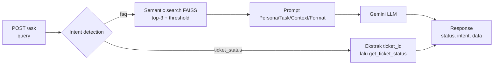

# IT Helpdesk Assistant — RAG + Mini-Agent

Backend API (FastAPI) yang menggabungkan **RAG** (menjawab pertanyaan kebijakan dari knowledge base) dan **router/tool call** (mengecek status tiket) dalam satu endpoint `/ask`, dikemas dalam container Docker.

Stack: Python 3.11, FastAPI, FAISS, Gemini API (`google-genai`), Docker.

## 1. Problem Statement

### Objective
Tim People & IT Operations menerima banyak pertanyaan berulang dari karyawan. Prototype ini otomatis menjawab dua jenis permintaan dalam satu sistem, tanpa campur tangan manusia untuk kasus yang jelas.

### Dua jenis permintaan user

| Jenis | Intent | Contoh | Ditangani oleh |
|---|---|---|---|
| Pertanyaan informasi/kebijakan | `faq` | "Berapa jatah cuti tahunan saya?", "Bagaimana cara reset password VPN?" | RAG (semantic search FAISS + LLM) |
| Permintaan cek data spesifik | `ticket_status` | "Apa status tiket TICKET-0042 saya?" | Tool call (lookup `mock_tickets.csv`) |

Status tiket **tidak** dijawab lewat RAG karena itu data terstruktur yang harus tepat; retrieval semantik hanya menghasilkan "yang paling mirip", bukan "yang persis sama".

### Batasan dan asumsi
- Knowledge base hanya 31 FAQ (`data/it_helpdesk_knowledge_base.csv`) dan data tiket hanya 15 baris mock (`TICKET-0001`..`TICKET-0015`). Tidak ada database sungguhan.
- Tidak ada autentikasi: sistem tidak memverifikasi siapa yang menanyakan sebuah tiket. Pada produksi, tiket harus dibatasi ke pemiliknya.
- Tidak ada memori percakapan; setiap request berdiri sendiri.
- Bahasa utama Bahasa Indonesia.
- Hanya dijalankan lokal / di container; tidak di-deploy ke cloud.

## 2. Desain Workflow



### Kriteria intent
Intent detection berjenjang (hybrid) agar cepat dan murah untuk kasus yang jelas, dengan LLM hanya untuk kasus ambigu:

| Urutan | Kondisi | Hasil |
|---|---|---|
| 1 | Ada pola ID tiket (`TICKET-0042`, `tiket 42`, `TKT-42`) | `ticket_status` (regex) |
| 2 | Frasa cek tiket ("status tiket", "cek tiket", "progres tiket") | `ticket_status` (regex) |
| 3 | Menyebut kata `tiket/ticket/status/progres/laporan` tapi tidak jelas | tanya Gemini (temperature 0) |
| 4 | Tidak ada sinyal tiket sama sekali | `faq` |

Contoh langkah 3: "Bagaimana cara mengajukan tiket untuk laptop baru?" menyebut "tiket" tetapi ini pertanyaan prosedur, sehingga LLM mengklasifikasikannya sebagai `faq`.

### Komponen
| File | Peran |
|---|---|
| `app/main.py` | FastAPI, endpoint `/ask` dan `/health`, error handling, bangun index saat startup |
| `app/router.py` | Intent detection, ekstraksi `ticket_id`, routing |
| `app/rag.py` | Embedding, index FAISS, semantic search, prompt + jawaban LLM |
| `app/tools.py` | `get_ticket_status` (tidak pernah crash; ID tak ditemukan dibalas pesan informatif) |
| `app/llm.py` | Klien Gemini bersama, retry error sementara, `LLMError` |

### Keputusan teknis
- **Embedding:** `gemini-embedding-001` (768 dimensi, dinormalisasi L2, `IndexFlatIP` = cosine similarity). Dokumen memakai `task_type=RETRIEVAL_DOCUMENT`, query memakai `RETRIEVAL_QUERY`. Unit retrievable = pertanyaan + jawaban.
- **Index dibangun sekali saat startup** (lifespan FastAPI), bukan per request.
- **LLM:** `gemini-3.5-flash`. Temperature **0.2** untuk jawaban RAG (setia pada knowledge base, tidak kreatif) dan **0.0** untuk klasifikasi intent (deterministik).
- **Prompt RAG** menginstruksikan LLM menjawab hanya dari context dan mengakui ketidaktahuan; ambang similarity (`MIN_SCORE = 0.45`) menyaring context yang tidak relevan.
- **Model dan embedding dapat diganti** lewat environment variable (`GEMINI_MODEL`, `GEMINI_EMBEDDING_MODEL`), karena nama model Gemini sering berubah. Pada pengerjaan ini `gemini-2.5-flash` ternyata sudah tidak tersedia untuk akun baru (404), sehingga default diganti.

### Format response `/ask`

```json
{ "status": "success", "intent": "faq", "data": "..." }
```

| Kondisi | HTTP | `status` | `intent` |
|---|---|---|---|
| Berhasil | 200 | `success` | `faq` / `ticket_status` |
| Query kosong / hanya spasi | 400 | `error` | `invalid_request` |
| Body tidak valid (field `query` hilang) | 422 | (format validasi FastAPI) | — |
| Intent tidak dikenali | 422 | `error` | `unknown` |
| LLM/embedding gagal (key salah, kuota, jaringan) | 503 | `error` | `llm_error` |
| Error tak terduga | 500 | `error` | `internal_error` |

## 3. Cara Menjalankan

Persiapan (untuk kedua cara):

```bash
cp .env.example .env     # Windows PowerShell: Copy-Item .env.example .env
# lalu isi GEMINI_API_KEY di .env (dapatkan di https://aistudio.google.com/apikey)
```

`.env` tidak boleh di-commit (sudah ada di `.gitignore` dan `.dockerignore`).

### Tanpa Docker

```bash
python -m venv .venv
source .venv/bin/activate          # Windows: .venv\Scripts\activate
pip install -r requirements.txt
uvicorn app.main:app --reload
```

### Dengan Docker

```bash
docker build -t it-helpdesk-assistant .
docker run -p 8000:8000 --env-file .env it-helpdesk-assistant
```

API key masuk lewat `--env-file` saat runtime; tidak ada di dalam image.

### Mencoba endpoint

```bash
curl -X POST http://localhost:8000/ask \
  -H "Content-Type: application/json" \
  -d '{"query": "berapa jatah cuti tahunan saya?"}'
```

Dokumentasi interaktif: http://localhost:8000/docs

### Menjalankan seluruh skenario uji

Dengan server berjalan (lokal atau Docker):

```bash
python tests/run_scenarios.py --url http://localhost:8000
```

> Catatan jaringan: jika jaringan Anda mencegat HTTPS (proxy/antivirus dengan CA sendiri), `pip` dan panggilan Gemini bisa gagal dengan `CERTIFICATE_VERIFY_FAILED`. Solusinya memasang CA jaringan tersebut ke trust store, bukan mematikan verifikasi TLS.

## 4. Hasil Pengujian

Dijalankan terhadap container Docker (`tests/run_scenarios.py`). Skenario 1–5 adalah yang diwajibkan brief; 6–8 adalah kasus tepi tambahan.

| # | Query | Intent diharapkan | Intent aktual | Respons | Routing |
|---|---|---|---|---|---|
| 1 | Berapa jatah cuti tahunan saya? | `faq` | `faq` | Karyawan tetap mendapat jatah 12 hari cuti tahunan, dapat diambil setelah masa kerja minimal 3 bulan. | ✅ |
| 2 | Gimana cara reset password VPN kalau akun saya terkunci? | `faq` | `faq` | Hubungi IT Support untuk reset; jika tidak terkunci, reset mandiri lewat portal self-service IT. | ✅ |
| 3 | Apa status tiket TICKET-0005 saya? | `ticket_status` | `ticket_status` | Tiket TICKET-0005 — Reset password VPN gagal terus (Access). Status: Diproses. Update terakhir: 2026-08-27. | ✅ |
| 4 | Tolong cek status TICKET-0999 | `ticket_status` | `ticket_status` | Tiket TICKET-0999 tidak ditemukan. Periksa kembali nomor tiket Anda (format: TICKET-XXXX). | ✅ |
| 5 | Bagaimana prakiraan cuaca di Jakarta besok? (di luar cakupan) | `faq` | `faq` | Menyatakan tidak memiliki informasi cuaca dan menyarankan mengajukan tiket ke IT Support/HR. | ✅ |
| 6 | Bagaimana cara mengajukan tiket untuk laptop baru? | `faq` | `faq` | Diajukan lewat tiket IT dengan justifikasi, perlu persetujuan manajer dan IT Asset. | ✅ |
| 7 | cek tiket 7 dong, sudah sampai mana? | `ticket_status` | `ticket_status` | Tiket TICKET-0007 — Permintaan monitor eksternal. Status: Menunggu Persetujuan. | ✅ |
| 8 | Status tiket saya bagaimana? | `ticket_status` | `ticket_status` | Meminta user menyebutkan nomor tiket. | ✅ |

**Routing benar: 8/8** (5/5 pada skenario wajib).

### Observasi
- **Router akurat pada seluruh skenario.** Kasus jelas (ada ID tiket) diputuskan regex tanpa memanggil LLM; skenario 6 yang "menyebut tiket tapi sebenarnya FAQ" berhasil dibedakan lewat fallback LLM.
- **Skenario 4 (tiket tidak ada)** ditangani tanpa crash dan mengembalikan HTTP 200 dengan pesan informatif, karena "tiket tidak ada" adalah hasil bisnis yang valid, bukan error sistem.
- **Skenario 5 (di luar cakupan)** tidak berhalusinasi: prompt membatasi jawaban pada context, dan LLM mengakui ketidaktahuannya. Perhatikan intent-nya tetap `faq` (tidak ada intent `out_of_scope` terpisah).
- **Normalisasi ID:** "tiket 7" dinormalisasi menjadi `TICKET-0007`, sehingga format penulisan user yang longgar tetap terbaca.
- Nilai jawaban LLM bisa sedikit berbeda antar-run (misalnya urutan kalimat), tetapi isinya tetap berasal dari knowledge base.

## 5. Keterbatasan

1. **Intent berbasis aturan rapuh pada frasa tak terduga.** Query tiket tanpa kata kunci apa pun ("TICKET" tidak disebut, mis. "laptop saya yang rusak kemarin sudah diperbaiki belum?") akan jatuh ke `faq`. Mengandalkan LLM untuk semua query menutup celah ini, tetapi menambah latensi dan biaya.
2. **Tidak ada intent `out_of_scope`.** Pertanyaan di luar cakupan tetap lewat jalur `faq` dan hanya ditolak oleh prompt, bukan oleh router. Akibatnya tetap memakai satu panggilan embedding dan satu panggilan LLM.
3. **Ambang `MIN_SCORE` ditentukan manual** dan belum dikalibrasi dengan data evaluasi yang cukup.
4. **Knowledge base kecil** (31 entri): query yang topiknya hampir sama dengan entri lain dapat mengambil context yang kurang tepat. Tidak ada reranking.
5. **Tidak ada autentikasi/otorisasi** pada pengecekan tiket: siapa pun yang tahu nomor tiket dapat melihat statusnya.
6. **Satu tiket per query**; jika user menyebut beberapa ID, hanya yang pertama diproses.
7. **Bergantung pada Gemini API**: jika kuota habis atau model padat, jawaban FAQ gagal (HTTP 503). Sudah ada retry ringan, tetapi tidak ada fallback ke model lain. Selain itu index FAISS di-embed ulang setiap startup (memanggil API), tidak disimpan ke disk.
8. **Pengujian baru 8 skenario manual**; belum ada uji otomatis (unit test) maupun evaluasi akurasi routing skala besar.

## 6. Perubahan setelah evaluasi (Assignment 5)

Beberapa perilaku pada dokumen ini sudah berubah setelah evaluasi; rinciannya di README root:
- `MIN_SCORE` kini **0.71** (hasil kalibrasi), bukan 0.45; query di bawah ambang dijawab pesan tetap **tanpa LLM**.
- Modul baru `app/guardrails.py` (override instruksi / pembocoran konfigurasi); intent baru `smalltalk` dan `guardrail_blocked` (status `refused`).
- Error validasi (kosong 400, terlalu panjang 422) memakai format `{status,intent,data}`.
- `GEMINI_THINKING_LEVEL` (default `minimal`) mengatur thinking model; sampai 5 ID tiket per query diproses.
